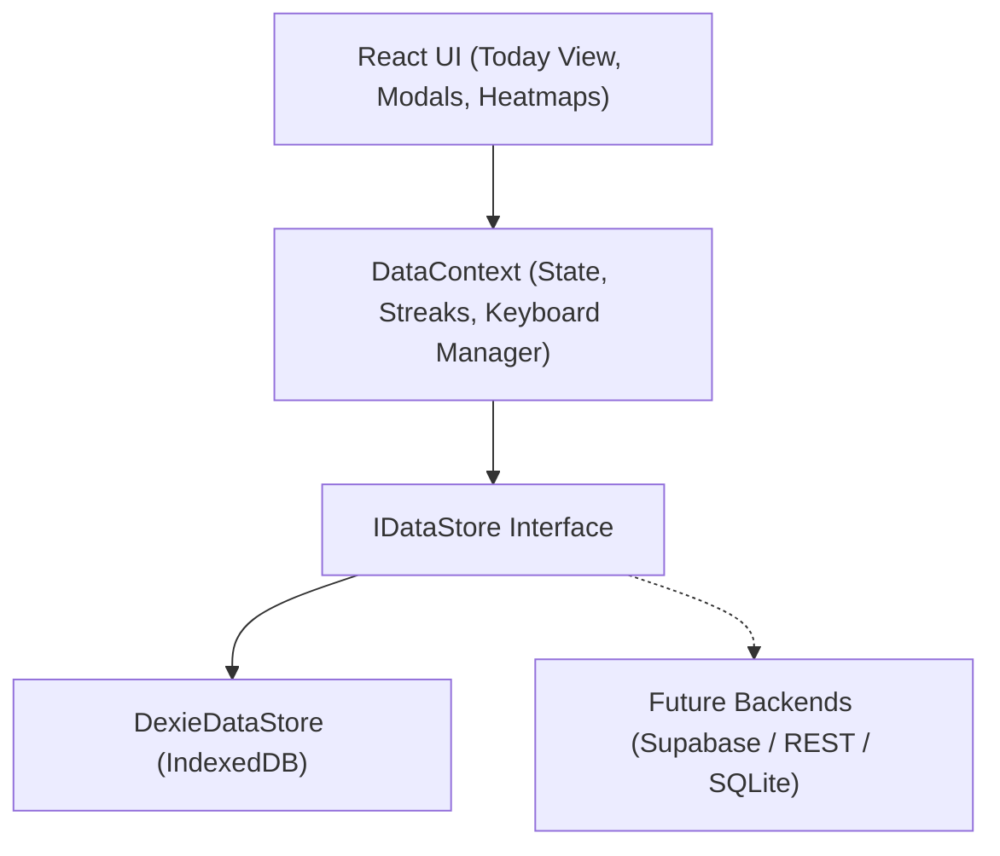

# Studio / Today — Habit Tracker & Task Manager

<p align="center">
  
</p>

<p align="center">
  <strong>An editorial, calm, and keyboard-first daily productivity studio.</strong><br>
  Harmonizing scheduled habits, streak tracking, a 90-day activity matrix, and task lists into a single distraction-free daily view.
</p>

<p align="center">
  <a href="#features">Features</a> •
  <a href="#visual-philosophy">Visual Philosophy</a> •
  <a href="#keyboard-shortcuts">Shortcuts</a> •
  <a href="#architecture--data-layer">Architecture</a> •
  <a href="#getting-started">Getting Started</a> •
  <a href="#testing">Testing</a>
</p>

---

## Highlights

- **Refined Editorial Aesthetics**: Magazine-grade typography with Newsreader / Instrument Serif, Inter Tight, and JetBrains Mono. Built entirely with warm neutrals (`#F5F4F0` and `#161514`), 1px hairline dividers, and zero generic card dropshadows.
- **Read-Time Derived Streaks**: Streaks and best streaks are never persisted as static counters. They are computed dynamically from `habitLogs` and schedule rules (daily vs. weekly active days) with zero drift.
- **90-Day Activity Matrix**: 13-week staggered load heatmaps per habit with interactive cell tooltips and backfill support.
- **Unified Task Hierarchy**: Parent tasks, due dates, priorities (low, medium, high), and nested subtasks with progress tracking.
- **Instant Persistence via Dexie.js**: All changes write immediately to IndexedDB with zero save delays and schema versioning.
- **Decoupled Store Abstraction**: All components interact through an `IDataStore` interface, enabling drop-in migration to Supabase, SQLite, or REST backends.
- **Data Mobility**: Complete JSON export and import in Settings for effortless backup and cross-device migration.
- **Keyboard-First Workflow**: Seamless control via hotkeys (`N`, `H`, `↑/↓`, `Enter`, `/`, `Esc`, `←/→`).

---

## Visual Philosophy

Unlike modern SaaS dashboards cluttered with purple gradients, blurred glassmorphic blobs, and rounded stat cards, **Studio / Today** is built as an intentional, contemplative tool for daily clarity.

```
┌───────────────────────────────────────────────────────────┐
│ STUDIO / TODAY                      28 OCT 2026   [Theme] │
│                                                           │
│ Tuesday                                                   │
│ 28 October 2026                                           │
│ ───────────────────────────────────────────────────────── │
│ ● 3 of 4 habits completed · 2 of 4 tasks due              │
│                                                           │
│ Habits (4)                                       + New [H]│
│ ───────────────────────────────────────────────────────── │
│ [✓] Morning Pages & Reflection        14d · best 28d  [▤] │
│ [ ] 45-Min Focused Reading             6d · best 18d  [▤] │
│     ■■■■■■■■■□■■■■■■■■■■■ (90-day activity grid)          │
│                                                           │
│ ───────────────────────────────────────────────────────── │
│ Tasks (3)                     [Today / All / Done] + New [N]│
│ ───────────────────────────────────────────────────────── │
│ [ ] ● Review quarterly architecture roadmap       Today   │
│     ↳ [✓] Inspect database latency metrics                │
│     ↳ [ ] Draft RFC for Supabase sync layer               │
│ [✓] Schedule dentist checkup and cleaning         Today   │
└───────────────────────────────────────────────────────────┘
```

- **Palette**: Warm neutrals. Near-black (`#161514`) text and dark-mode canvas, warm off-white (`#F5F4F0`) light canvas, subtle warm stone hairline borders (`#DFDCD5` / `#2B2926`), and a single muted pine/sage accent (`#394639` / `#465547`) used exclusively for completed states.
- **Typography Scale**: Refined serif display headers (`Newsreader` / `Instrument Serif`), clean sans UI (`Inter Tight` / `Geist`), and monospace numerals (`JetBrains Mono`).
- **Narrow Focus**: A disciplined 640px centered column with generous whitespace that fits naturally on desktops, tablets, and phones.

---

## Keyboard-First Navigation

Navigate your entire day without touching your mouse:

| Shortcut | Action | Description |
| :---: | :--- | :--- |
| <kbd>N</kbd> | **New Task** | Opens the task creation modal with priority and subtasks |
| <kbd>H</kbd> | **New Habit** | Opens habit creator with daily/weekly cadence selector |
| <kbd>↑</kbd> / <kbd>↓</kbd> | **Navigate Items** | Move selection between habits and tasks |
| <kbd>↵ Enter</kbd> | **Toggle Item** | Check off or reactivate selected habit log or task |
| <kbd>/</kbd> | **Filter / Search** | Opens quick search command bar across all entries |
| <kbd>←</kbd> / <kbd>→</kbd> | **Date Navigation** | Step backward or forward through past/future dates |
| <kbd>Esc</kbd> | **Dismiss** | Closes modals, clears active search, or removes selection |

---

## Architecture & Data Layer



### IndexedDB Schema (Version 1)

```typescript
// Dexie Schema Definition
db.version(1).stores({
  habits: 'id, archived, createdAt',
  habitLogs: 'id, habitId, date, [habitId+date]',
  tasks: 'id, dueDate, priority, done, createdAt, parentId',
});
```

### Pure Read-Time Streak Engine

Streaks are computed on demand by scanning calendar days backwards:
1. **Scheduled Cadence**: Daily habits evaluate every day; weekly habits only evaluate designated weekdays (`schedule.days: [1, 3, 5]`). Non-scheduled rest days never break a streak.
2. **Current Streak**: Evaluates contiguous completed scheduled days. If today is incomplete, previous days' streak is preserved until the calendar day concludes.
3. **Best Streak**: Walks complete historical logs from habit inception to determine all-time peak consecutive consistency.

---

## Getting Started

### Prerequisites

- Node.js (v18.0.0 or higher)
- npm, pnpm, or bun

### Installation

```bash
# Clone the repository
git clone https://github.com/thenakshprajapat/habitsAndTasks_manager.git
cd habitsAndTasks_manager

# Install dependencies
npm install

# Start local development server
npm run dev
```

Visit `http://localhost:5173/` in your browser.

---

## Project Structure

```
habitsAndTasks_manager/
├── src/
│   ├── assets/               # SVG and static assets
│   ├── components/           # Component library
│   │   ├── CommandBar.tsx    # Keyboard-triggered quick filter
│   │   ├── HabitHeatmap.tsx  # 90-day activity matrix with staggered load
│   │   ├── HabitItem.tsx     # Habit checklist row & streak counter
│   │   ├── HabitModal.tsx    # Habit creation & editing dialog
│   │   ├── HabitsSection.tsx # Today's scheduled habits list
│   │   ├── Header.tsx        # Editorial asymmetric header & calendar ticker
│   │   ├── KeyboardShortcutsFooter.tsx # Persistent hotkey helper bar
│   │   ├── SettingsModal.tsx # JSON export/import and database controls
│   │   ├── TaskItem.tsx      # Task row with priority & nested subtasks
│   │   ├── TaskModal.tsx     # Task creation & editing dialog
│   │   └── TasksSection.tsx  # Today's task checklist & view switcher
│   ├── context/
│   │   ├── DataContext.tsx   # Reactive state, keyboard navigation & auto-save
│   │   └── ThemeContext.tsx  # Dark / light mode state manager
│   ├── storage/
│   │   ├── db.ts             # Dexie.js database instance & versioned schema
│   │   └── DataStore.ts      # Concrete IDataStore implementation
│   ├── types/
│   │   └── index.ts          # TypeScript domain interfaces
│   ├── utils/
│   │   ├── dateUtils.ts      # Local calendar arithmetic & editorial formatting
│   │   ├── streakUtils.ts    # Pure streak calculation & 90-day grid generator
│   │   └── streakUtils.test.ts # Vitest suite for edge-case streak logic
│   ├── App.tsx               # Root component with providers
│   ├── AppContent.tsx        # Layout & global keyboard listeners
│   ├── index.css             # Tailwind v4 theme tokens & warm neutrals system
│   └── main.tsx              # Application entry point
├── index.html                # Google Fonts preconnect & meta tags
├── vite.config.ts            # Vite & Tailwind CSS v4 configuration
└── package.json
```

---

## Testing

Run the automated test suite powered by [Vitest](https://vitest.dev/):

```bash
# Run tests once
npm run test:run   # or: npx vitest run

# Run tests in watch mode
npx vitest
```

### Test Coverage Highlights
- ✅ Daily consecutive completion calculations
- ✅ Pending state on today preserving previous streak
- ✅ Broken streak on past missed scheduled days
- ✅ Weekly habit schedules skipping non-active weekdays without penalty
- ✅ Peak historical best streak retention
- ✅ 90-day activity matrix window boundary verification

---

## Building for Production

```bash
# Type check and build optimized bundle
npm run build

# Preview production build locally
npm run preview
```

Output is compiled to the `dist/` folder with zero external runtime dependencies beyond React and Dexie.

---

## License

MIT License © 2026 Naksh Prajapat. Free for personal and commercial use.
